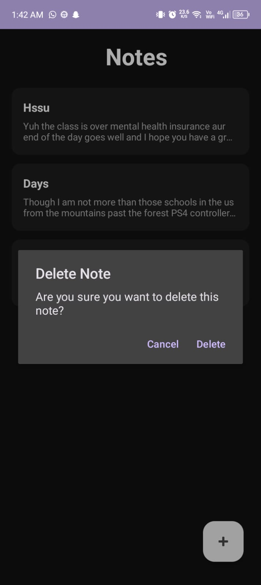

# Notes App 

A modern dark-themed native Android notes application built with
Java and Room Database, featuring full CRUD operations.

##  Preview

##  Features
- Create new notes with title and content
- Edit existing notes
- Delete notes with long press confirmation dialog
- Notes persist permanently using Room Database
- Clean dark themed UI
- Floating Action Button to add new notes
- RecyclerView with card-based note list

## ️ Built With
- Java
- Android SDK
- Room Database
- RecyclerView & CardView
- Material Design (FAB, AlertDialog)
- ConstraintLayout
- Android Studio

## Concepts Covered
- Room Database — Entity, DAO, AppDatabase
- CRUD operations — Create, Read, Update, Delete
- Singleton pattern for database instance
- onResume() for list refresh
- AlertDialog for delete confirmation
- Long click listeners
- Custom interface callbacks (OnNoteClickListener, OnNoteLongClickListener)
- Multi-screen navigation with Intents
- Passing data between Activities

##  Getting Started
1. Clone the repository
2. Open in Android Studio
3. Run on device or emulator (API 24+)
4. Tap + to create a note
5. Tap a note to edit it
6. Long press a note to delete it

##  Author
Abdullah Ashfaq — [@Abdullah-2238](https://github.com/Abdullah-2238)